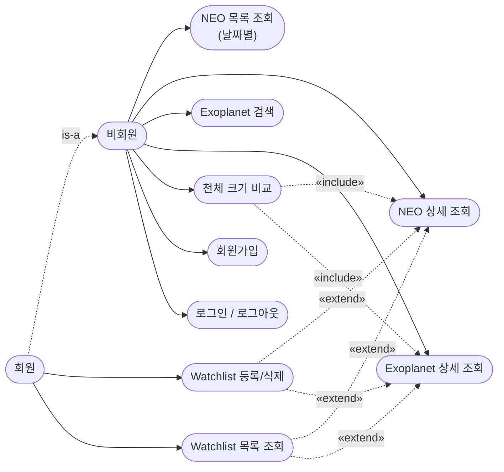

# Cosmic Watch & Explorer — 요구사항 및 기능명세서
 
| 항목 | 내용 |
|---|---|
| 문서 번호 | 01 |
| 문서명 | 요구사항 및 기능명세서 |
| 프로젝트명 | Cosmic Watch & Explorer (통합 천문 관제·탐색 포털) |
| 작성자 | 사공민규 |
| 버전 | v1.11 |
| 최종 수정일 | 2026-10-27 |
| 상태 | 확정 |

**변경 이력**

| 버전 | 날짜 | 변경 내용 |
|---|---|---|
| v1.0 | 2026-08-21 | 최초 작성 |
| v1.1 | 2026-09-10 | 3.3 유즈케이스 다이어그램 신설 |
| v1.2 | 2026-10-27 | 3.2 MVP 제외 범위에 "헤더 통합 검색", "다음 접근 카운트다운 API" 후보 추가 |
| v1.3 | 2026-10-27 | 2.2절 사용자 유형 ─ 비회원 탐색 제거(모든 화면·조회 API 로그인 필요로 변경). 3.3절 유즈케이스 각주에 변경 표시 |
| v1.4 | 2026-10-28 | 9장 MVP 완료 기준 19개 실측 대조 → 전부 체크, 대조 결과 표 추가 (항목 수 19개 ─ 05·DEVLOG의 "22개" 오기 정정) |
| v1.5 | 2026-10-28 | 3.2 MVP 제외 범위에 "비밀번호 변경·회원 탈퇴" 후보 추가 |
| v1.6 | 2026-10-28 | 마이페이지를 회원 기능으로 추가(사용자 결정) ─ 3.2절에 "나중에"로 적었던 "비밀번호 변경·회원 탈퇴"를 범위 안으로 옮김 |
| v1.7 | 2026-10-28 | 회원 기능에 프로필 사진·프로필 미니 메뉴 추가(사용자 요청) |
| v1.8 | 2026-10-28 | 3.2절: 통합 검색·카운트다운 → M7-2 계획 확정, 데스크톱 앱 → M8, 선택 4개 → M7-4 (05 문서 10·11장) |
| v1.9 | 2026-10-28 | 3.2절: 카운트다운 구현 완료(M6로 당김) 표시 |
| v1.10 | 2026-10-28 | 3.2절: 일식·월식 일정 → M7-3 계획 |
| v1.11 | 2026-10-28 | 3.2절: 일식·월식 한국 가시성은 직접 계산 예외 허용(사용자 결정) |

---
 
## 1. 프로젝트 목적
 
Cosmic Watch & Explorer는 NASA 및 공개 천문 데이터를 활용하여 지구 근접 소행성(NEO)과 외계행성(Exoplanet)의 정보를 통합적으로 조회하고 탐색할 수 있는 웹 기반 천문 관제·탐색 포털이다.
 
주요 목적은 다음과 같다.
 
- 지구 근접 소행성의 접근 정보 및 위험 여부 모니터링
- 외계행성의 다양한 조건 기반 검색
- 천체의 상세 정보 및 궤도 데이터 제공
- NEO, 지구, 외계행성의 크기 비교
- 사용자의 관심 천체 Watchlist 관리
### 1.1 용어 정의에 관한 주의
 
본 서비스는 NASA API가 제공하는 데이터를 **주기적으로 수집·갱신하여 제공**하는 서비스이며, 천체를 직접 실시간 관측하는 시스템이 아니다.
 
따라서 문서 및 포트폴리오 상에서 "실시간 관측 시스템"이라는 표현은 사용하지 않고, **"통합 천문 관제·탐색 포털"** 로 표기한다.
 
---
 
## 2. 프로젝트 대상 사용자
 
### 2.1 주요 사용자
 
천문학에 관심이 있는 일반 사용자를 주요 대상으로 한다. 전문적인 천문학 지식이 없어도 NEO 및 외계행성의 주요 정보를 쉽게 조회하고 탐색할 수 있도록 구성한다.
 
예상 사용 상황은 다음과 같다.
 
- 오늘 지구에 접근하는 소행성이 궁금한 경우
- 특정 외계행성을 검색해 보고 싶은 경우
- 행성 크기를 지구와 비교해 보고 싶은 경우
- 관심 있는 천체를 저장해두고 싶은 경우
### 2.2 사용자 유형
 
| 사용자 유형 | 주요 이용 목적 |
|---|---|
| 비회원 | ~~NEO / 외계행성 정보 탐색~~ → 로그인·회원가입만 (10-27 변경) |
| 회원 | 탐색 + Watchlist 관리 |
| 관리자 | Django Admin을 통한 데이터 관리 |
 
#### 비회원 사용자

> ⚠️ **2026-10-27 변경 ─ 모든 화면·조회 API가 로그인 필요.** 처음 설계는 비회원도 탐색할 수 있었지만, 로그인 기능이 생긴 뒤 화면을 잠그기로 결정했다(사용자 결정). 화면만 잠그면 API 주소로 데이터가 그대로 보여서 API도 같이 잠갔다. 비로그인으로 열리는 건 로그인·회원가입뿐이다. 아래 "비회원" 기능은 이제 "회원" 기능이다.

 
- NEO 정보 조회
- NEO 접근 정보 확인
- 외계행성 검색
- 외계행성 상세 정보 조회
- 천체 크기 비교
#### 회원 사용자
 
비회원 기능을 포함하며 다음 기능을 추가로 이용할 수 있다.
 
- NEO Watchlist 등록 / 삭제
- Exoplanet Watchlist 등록 / 삭제
- 자신의 Watchlist 조회
- 마이페이지 (10-28 추가) ─ 내 정보 확인, 이메일·비밀번호 변경, 회원 탈퇴, 대시보드 표시 설정(보조 거리 단위·기본 정렬·위험만 보기)
- 프로필 사진 (10-28 추가) ─ 직접 올려 헤더 프로필 원 꾸미기, 기본(머리글자)으로 되돌리기. 헤더 프로필 원을 누르면 미니 메뉴(내 계정·내 관심 천체·로그아웃)
#### 관리자
 
별도의 관리자 웹페이지는 개발하지 않는다. 서비스 데이터 관리는 Django Admin을 활용한다.
 
> **설계 판단**
> 회원 기능의 핵심 목적은 "관심 있는 천체를 저장한다" 하나이다. 로그인 시스템을 과도하게 확장하지 않는다.
 
---
 
## 3. 서비스 범위
 
### 3.1 MVP 포함 범위
 
#### NEO
 
- 날짜별 NEO 조회
- NASA API를 통한 NEO 데이터 수집
- DB 캐싱
- NEO 목록 조회
- 잠재적 위험 소행성 표시
- 접근 거리 및 속도 표시
- NEO 상세 정보
- 접근 이력 조회
- 궤도 정보 조회
#### Exoplanet
 
- 외계행성 목록 조회
- 다중 조건 검색
- 페이징
- 외계행성 상세 정보
- 모항성 정보 조회
#### 공통
 
- 천체 크기 비교
- 회원가입
- 로그인 / 로그아웃
- Watchlist
### 3.2 MVP 제외 범위
 
다음 기능은 초기 버전에서 구현하지 않는다.
 
| 제외 기능 | 제외 사유 |
|---|---|
| 실시간 천체 위치 추적 | NASA API 데이터만으로 현재 위치를 실시간 렌더링할 필요가 없음 |
| 3D 우주 시뮬레이션 | 프로젝트 핵심 기능이 아님 |
| 자체 궤도 계산 엔진 | NASA가 제공하는 계산 결과를 활용 (예외: 일식·월식의 한국 가시성 ─ 위 행, 10-28) |
| ~~헤더 통합 검색 (Ctrl K로 소행성·외계행성 이름 검색)~~ | → 10-28 **M7-2로 계획 확정** (05 문서 10장). 처음엔 10-27 목업에서 나온 후보였다 (범위 관리 규칙 05 문서 12.1절) |
| ~~대시보드 "다음 접근까지" 카운트다운 API~~ | → 10-28 M7-2로 계획 확정 → **같은 날 M6에서 구현 완료** (사용자 요청, 04 문서 5.4절). 03 문서 6.1절 와이어프레임에 있었지만 API가 없어 보류했던 것 ─ MVP 완료 기준(9장)에는 없었다 |
| 일식·월식 일정 | → 10-28 사용자 요청으로 **M7-3에 계획** (05 문서 10장, 새 메뉴). 공개 기관(USNO·NASA) 표가 먼저. 단 **"한국에서 보이나"는 표에 없으면 직접 계산 허용** ─ 아래 "자체 궤도 계산 엔진 제외"의 유일한 예외(10-28 사용자 결정), 공개 자료와 대조 필수 |
| 천문 관측 장비 연동 | 범위 외 |
| 댓글 및 소셜 기능 | 서비스 정체성과 무관 |
| 별도의 관리자 웹페이지 | Django Admin으로 대체 |
| 모바일 앱 | 범위 외 |
| 데스크톱 앱 | → 10-28 사용자 요청으로 **M8로 계획** (05 문서 11장). 모바일 앱은 계속 제외 |
| 생명 가능 지대·기간 조회·접근 연표·이메일 알림 | → 10-28 **M7-4(선택)로 계획** (05 문서 10장) |
 
---

### 3.3 유즈케이스 다이어그램

M2까지 구현된 기능(4장 기준)을 사용자 관점에서 정리한다.



**설계 근거**

- `UC5 크기 비교`가 `UC2`/`UC4`에 `«include»`인 이유: 크기 비교를 하려면 반드시 NEO나 Exoplanet의 직경/반지름 데이터를 먼저 가져와야 한다 — 선택이 아니라 필수 경유.
- `UC8 Watchlist 등록`이 `«extend»`인 이유: 상세 페이지 열람과 별개로, 로그인한 회원만 선택적으로 붙는 동작이다.
- ⚠️ (10-27 변경) 지금은 조회도 로그인이 필요하다 ─ 2.2절 각주. 아래 각주는 처음 설계 당시의 근거로 남겨 둔다.
- 로그인을 `«include»`로 넣지 않은 이유: 비로그인 상태에서도 NEO/Exoplanet 조회는 끝까지 완결되는 유즈케이스라, 로그인은 Watchlist 쪽에만 조건으로 붙는다.
- 필터(자치구/행정동 방식의 검색 조건)는 별도 유즈케이스로 쪼개지 않았다. "조건으로 상권을 탐색한다"처럼 하나의 목표 아래 선택 조건으로 묶이는 것이지, 조건 하나하나가 "이걸 하려고 앱을 켰다"에 해당하지 않기 때문이다.

---
 
## 4. 기능 요구사항
 
### 4.1 NEO 대시보드
 
#### 목적
 
NASA NEO API 데이터를 수집·저장하고, 사용자가 날짜별 지구 근접 소행성을 조회할 수 있도록 한다.
 
#### 주요 기능
 
- 날짜 선택
- 날짜별 NEO 목록 조회
- NEO 이름 표시
- 추정 직경 표시
- 잠재적 위험 여부 표시
- 지구 접근 거리 표시
- 상대 속도 표시
- 거리 / 속도 / 크기 기준 정렬
- NEO 상세 페이지 이동
- 주요 데이터를 차트로 시각화
#### 조회 단위
 
MVP에서는 **하루 단위 조회**를 기본으로 한다. NASA NEO Feed API가 날짜 단위 조회에 최적화되어 있고, 구현 난이도가 낮다.
 
#### 데이터 처리 흐름
 
```text
사용자
  ↓
React
  ↓
Django REST API
  ↓
MariaDB 조회
```
 
DB에 필요한 데이터가 없는 경우:
 
```text
Django
  ↓
NASA NEO API 호출
  ↓
데이터 정제
  ↓
MariaDB 저장
  ↓
React 응답
```
 
#### 중요 정책
 
- React에서 NASA API를 **직접 호출하지 않는다.**
- NASA API Key는 **백엔드에서만** 관리한다.
```text
❌ React → NASA API
⭕ React → Django API → DB
                ↓
          (필요 시) NASA API
```
 
---
 
### 4.2 NEO 상세
 
#### 목적
 
특정 NEO의 상세 정보와 과거 및 미래 접근 정보를 제공한다.
 
#### 주요 기능
 
- NEO 이름
- NASA ID
- 추정 직경 (최소 / 최대)
- 절대등급
- 잠재적 위험 여부
- Sentry Object 여부
- 지구 접근 기록
- 접근 날짜
- 접근 거리
- 상대 속도
- 궤도 정보
- 궤도 분류
- NASA / JPL 상세 페이지 연결
- Watchlist 등록 / 삭제
#### 접근 기록
 
사용자에게 다음 정보를 제공한다.
 
- 접근 날짜
- 접근 대상 (orbiting body)
- 지구와의 거리
- 상대 속도
과거 및 미래 접근 기록을 모두 조회할 수 있다.
 
---
 
### 4.3 Exoplanet 카탈로그
 
#### 목적
 
공개 외계행성 데이터를 검색 조건에 따라 탐색할 수 있도록 한다.
 
#### 검색 조건
 
- 행성명
- 모항성명
- 행성 반지름
- 행성 질량
- 평형 온도
- 지구로부터의 거리
- 공전 주기
- 발견 연도
- 발견 방법
#### 기능
 
- 다중 조건 검색
- 조건 조합 검색
- 검색 결과 페이징
- 정렬
- 외계행성 상세 페이지 이동
- Watchlist 등록 / 삭제
#### 검색 처리
 
Django ORM을 사용하여 **서버에서** 검색 조건을 처리한다.
 
```text
React
  ↓
검색 조건
  ↓
Django REST API
  ↓
Django ORM
  ↓
MariaDB
```
 
---
 
### 4.4 Exoplanet 상세
 
#### 행성 정보
 
- 행성명
- 행성 반지름
- 행성 질량
- 평형 온도
- 공전 주기
- 발견 연도
- 발견 방법
#### 모항성 정보
 
- 모항성명
- 지구와의 거리
- 분광형
- 항성 온도
- 항성 반지름
- 항성 질량
- 금속성
- 표면중력
#### 추가 기능
 
- Watchlist 등록 / 삭제
- 크기 비교 페이지 이동
---
 
### 4.5 천체 크기 비교
 
#### 목적
 
천문 데이터를 숫자로만 보여주지 않고, 사용자가 천체의 상대적인 크기를 직관적으로 이해할 수 있도록 한다.
 
#### 비교 대상
 
- 지구
- NEO
- Exoplanet
#### 기능
 
- 지구 대비 크기 비교
- 선택한 천체 간 크기 비교
- 최소 / 최대 추정 직경을 활용한 NEO 크기 범위 표시
- 행성 반지름을 활용한 Exoplanet 크기 비교
#### 주의사항
 
NEO의 경우 NASA API가 정확한 직경 하나가 아닌 **최소 / 최대 추정 직경**을 제공하므로, 단일 확정값으로 표시하지 않는다.
 
---
 
### 4.6 회원가입 / 로그인
 
#### 회원가입
 
사용자는 다음 정보를 입력하여 회원가입한다.
 
- 사용자명
- 이메일
- 비밀번호
#### 로그인
 
Django 인증 시스템을 이용한다. 로그인 성공 시 인증된 사용자만 사용할 수 있는 기능에 접근할 수 있다.
 
#### 인증이 필요한 기능
 
- Watchlist 조회
- Watchlist 등록
- Watchlist 삭제
---
 
### 4.7 Watchlist
 
#### NEO Watchlist
 
회원은 관심 있는 NEO를 저장할 수 있다.
 
- NEO 저장
- NEO 저장 취소
- 저장된 NEO 목록 조회
- NEO 상세 페이지 이동
#### Exoplanet Watchlist
 
회원은 관심 있는 외계행성을 저장할 수 있다.
 
- 외계행성 저장
- 저장 취소
- 저장된 외계행성 목록 조회
- 외계행성 상세 페이지 이동
#### 중복 방지
 
동일 사용자가 동일 천체를 중복 저장할 수 없도록 한다.
 
---
 
## 5. 데이터 수집 및 캐싱 요구사항
 
### 5.1 NEO 데이터
 
NASA NEO API를 외부 데이터 소스로 사용한다. 외부 API 데이터를 Django 백엔드에서 수집한 후, 필요한 데이터를 MariaDB에 저장한다.
 
### 5.2 캐싱 전략
 
사용자가 조회할 때마다 NASA API를 호출하지 않는다.
 
```text
사용자 요청
    ↓
  DB 확인
    ↓
 데이터 존재?
 ┌────┴────┐
YES        NO
 ↓          ↓
DB 응답   NASA API 호출
              ↓
           DB 저장
              ↓
            응답
```
 
#### 기대 효과
 
- NASA API 호출 횟수 감소
- 응답 속도 개선
- API 장애 시 기존 데이터 활용
- API Key 보호
---
 
## 6. 기능 우선순위
 
| 기능 | 우선순위 |
|---|---|
| NEO 데이터 수집 | P0 |
| NEO DB 저장 | P0 |
| NEO 목록 조회 | P0 |
| NEO 상세 조회 | P0 |
| Exoplanet 데이터 저장 | P0 |
| Exoplanet 검색 | P0 |
| Exoplanet 상세 조회 | P0 |
| 회원 인증 | P1 |
| Watchlist | P1 |
| 크기 비교 | P1 |
| 차트 시각화 | P1 |
| 정렬 / 검색 고도화 | P2 |
 
#### 우선순위 기준
 
- **P0** — 서비스 핵심 기능. 반드시 구현
- **P1** — 주요 서비스 기능. MVP에 포함
- **P2** — 완성도를 높이는 기능. 일정에 따라 조정
---
 
## 7. 비기능 요구사항
 
### 7.1 보안
 
- NASA API Key를 프론트엔드에 노출하지 않는다.
- API Key는 환경변수로 관리한다.
- 비밀번호는 평문으로 저장하지 않는다.
- 인증이 필요한 API는 인증 여부를 검증한다.
### 7.2 성능
 
- NEO 데이터는 DB 캐싱을 사용한다.
- Exoplanet 검색은 서버 측 페이징을 적용한다.
- 목록 API에서 불필요한 데이터를 과도하게 반환하지 않는다.
### 7.3 데이터 무결성
 
- PK / FK를 이용하여 테이블 관계를 유지한다.
- Watchlist 중복 등록을 방지한다.
- NASA 데이터의 NULL 값을 임의의 값으로 변환하지 않는다.
### 7.4 유지보수성
 
Backend와 Frontend를 분리한다.
 
```text
React
  ↕
REST API
  ↕
Django REST Framework
  ↕
MariaDB
```
 
외부 NASA API와의 통신 로직 역시 일반적인 비즈니스 로직과 분리한다.
 
---
 
## 8. 기술적 제약사항
 
| 구분 | 기술 |
|---|---|
| Backend | Python, Django, Django REST Framework |
| Frontend | React |
| Database | MariaDB |
| DB 관리 도구 | HeidiSQL |
| External API | NASA NEO API (NeoWs) |
| Exoplanet Data | NASA Exoplanet Archive 기반 공개 데이터 |
 
---
 
## 9. MVP 완료 기준
 
다음 조건을 모두 만족하면 MVP가 완료된 것으로 정의한다.
 
### NEO
 
- [x] NASA NEO 데이터를 정상적으로 수집할 수 있다.
- [x] 수집한 데이터를 MariaDB에 저장할 수 있다.
- [x] 날짜별 NEO를 조회할 수 있다.
- [x] NEO 상세 정보를 조회할 수 있다.
- [x] 접근 정보를 확인할 수 있다.
- [x] 기본 차트를 확인할 수 있다.
### Exoplanet
 
- [x] 외계행성 데이터를 DB에 저장할 수 있다.
- [x] 외계행성 목록을 조회할 수 있다.
- [x] 여러 조건으로 검색할 수 있다.
- [x] 페이징이 동작한다.
- [x] 상세 정보를 확인할 수 있다.
### 사용자
 
- [x] 회원가입이 가능하다.
- [x] 로그인이 가능하다.
- [x] NEO를 Watchlist에 추가할 수 있다.
- [x] Exoplanet을 Watchlist에 추가할 수 있다.
- [x] Watchlist를 조회 / 삭제할 수 있다.
### 공통
 
- [x] 지구와 천체의 크기를 비교할 수 있다.
- [x] Backend API와 React가 정상적으로 통신한다.
- [x] 주요 데이터가 MariaDB에 정상적으로 저장된다.

#### 대조 결과 (2026-10-28, 회사 PC) ─ 19개 전부 충족

> 항목 수는 **19개**다(NEO 6 · Exoplanet 5 · 사용자 5 · 공통 3). 05 문서·DEVLOG에 "22개"로 적혀 있던 것은 오기라 함께 고쳤다.
> 증거는 "속을 수 없는 형태"로만 ─ NASA 원본을 직접 불러 비교하거나, 서버 코드와 무관한 DB 쿼리로 대조했다.

| 항목 | 증거 |
|---|---|
| NEO 수집·DB 저장 | 처음 조회하는 `2026-11-12`: 조회 전 NeoFetchLog 0 · 접근 0 → 대시보드 조회 → NeoFetchLog 1행(element_count 4), CloseApproach 4건. NASA Feed 직접 호출도 4건, **nasa_id 4개 동일** |
| 날짜별 조회 · 기본 차트 | 같은 날짜 화면 목록 4건 = API 4건, 산점도 점 4개, 차트 2개(스케일 바·산점도). 두 번째 요청은 `is_cached: true` |
| NEO 상세 · 접근 정보 | `/neo/3789097` 이름·궤도(이심률) 화면 표시, 다음 접근 5건 + "전체 접근 기록 15건 보기" → 15행 = API `approach_count` 15 |
| 외계행성 DB 저장 | DB Exoplanet 6,451 · HostStar 4,847 = NASA Exoplanet Archive TAP 직접 집계(`default_flag = 1`) 6,451 · 4,847 |
| 목록 · 페이징 | 화면 "6,451건" 20행, total_pages 323, 1·2쪽 겹침 0, 마지막 쪽 11행(= 6,451 − 322×20), 324쪽은 404 NOT_FOUND, 화면 2쪽 첫 행 = API 2쪽 첫 행 |
| 여러 조건 검색 | 반지름 0.8~1.5 + 100광년 이하 → 화면 53건·칩 2개. filters.py·units.py를 쓰지 않은 **독립 ORM 쿼리도 53건, id 집합 완전 일치** |
| 외계행성 상세 | `/exoplanets/54` GJ 3473 b ─ 모항성 이름 표시 |
| 회원가입 · 로그인 | 화면에서 가입 → `/me/` 본인, 로그아웃 → 비로그인, 같은 계정 로그인 → 본인. DB 비밀번호는 해시로 저장 |
| Watchlist 추가 · 조회 · 삭제 | NEO 3789097·외계행성 54 저장 → 탭 "소행성 1 · 외계행성 1" → 소행성 삭제(실행 취소 안 함) → 서버 0건, DB NeoWatchlist 0 · ExoplanetWatchlist [54] |
| 크기 비교 | `/compare?exo=54&neo=3789097` 지구 고정(빼기 버튼 없음), 소행성 이중 원, 표 3행 |
| API ↔ React 통신 | 위 흐름의 API 호출 13건 전부 2xx, 화면 오류 0 |

**대조 중 발견·수정**: 처음 조회하는 날짜가 503(UPSTREAM_ERROR)으로 실패 ─ 서비스의 `print()` 문구 "—"가 파이프 출력(cp949)에서 깨져 저장 후 예외. `logging`으로 교체(DEVLOG 10-28).
---
 
## 10. 문서 진행 계획
 
```text
01 요구사항 + 기능명세서   ✅ 완료 (본 문서)
        ↓
02 사용자 시나리오 + UI/UX  ← 다음
        ↓
03 DB 설계서
        ↓
04 API 명세서
        ↓
05 Django + React 실제 개발
```
 
> DB 설계는 이미 상당 부분 논의되었으나, 요구사항과의 대조 검증을 거쳐 03번 문서에서 확정한다.
